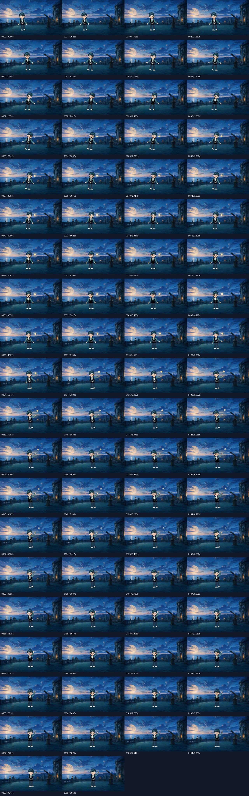
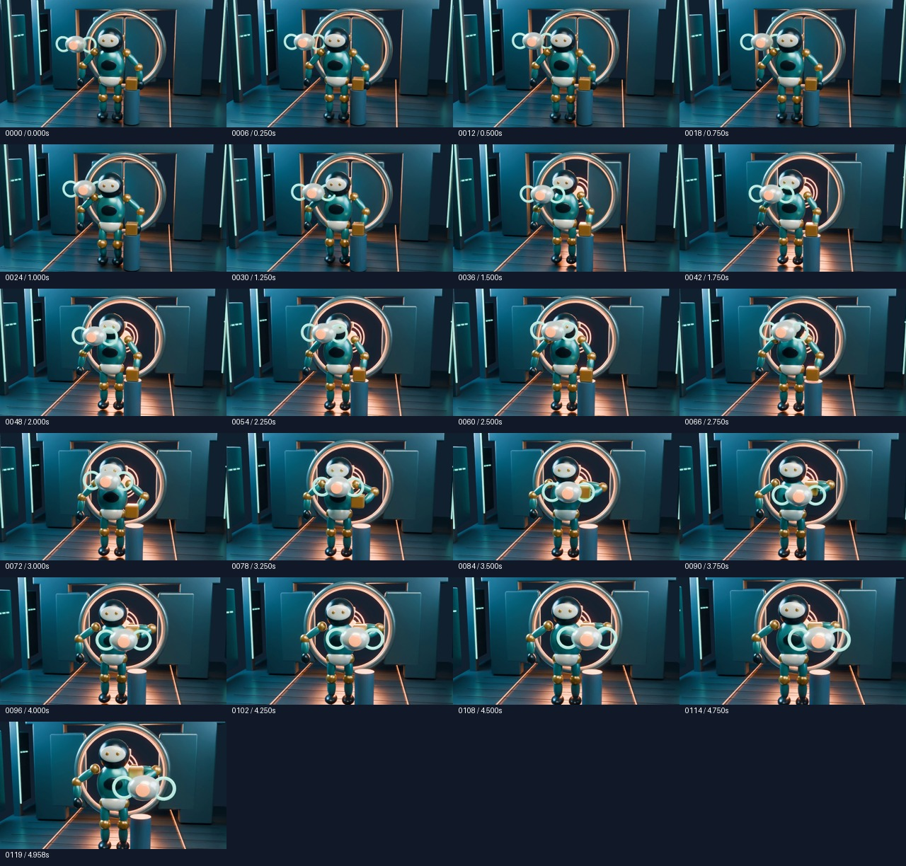

# Animation Agent Studio

**One repository that tells an agent how to make animation—and gives it the tools to do the work.**

Start with a brief, load the right creative playbook, author editable 2D/3D scenes, render locally, inspect real frames and deliver source plus honest QA. Works as repository guidance for a browsing chat, a local CLI, or an MCP-connected agent.

> A repository link provides methods, schemas and examples. It does not change model weights or magically install engines. This is a production toolkit, not a universal text-to-video model.

## Start in the way you work

| Mode | Start here | What the agent can do |
|---|---|---|
| **Link a chat** | [Connect guide](docs/CONNECT.md#1-link-only-chat-methods-and-source-guidance) | Read the playbooks, critique/design, author SVG/JSON and plan shots |
| **Open in a coding agent** | [AGENTS.md](AGENTS.md) → `python3 scripts/bootstrap.py` | Author, render, inspect and revise with local tools |
| **Connect MCP** | [Connect guide](docs/CONNECT.md#3-mcp-host-actual-local-production-tools) | Use validated scene tools, speech/reactions, Blender and QA |

### One-command local setup

Python 3.11+, FFmpeg and ffprobe. Blender 4.5+ is optional for 3D.

```bash
python3 scripts/bootstrap.py
# Windows: py -3 scripts/bootstrap.py
# Prove Blender too: python3 scripts/bootstrap.py --smoke-3d
```

Bootstrap creates/reuses `.venv`, installs the toolkit and runs a tiny real SVG→H.264 encode/decode check. It does **not** download models or reference corpora. Then:

```bash
.venv/bin/animation-studio doctor --smoke
.venv/bin/python scripts/configure_client.py --output output/mcp-client.json
```

## The agent's skill library

Read [the operating contract](skills/animation-director/SKILL.md) first; then route through [skills/index.json](skills/index.json).

| Skill | What it teaches |
|---|---|
| [Animation director](skills/animation-director/SKILL.md) | Brief → storyboard → proof → production → review → delivery |
| [Drawing](skills/drawing/SKILL.md) | Gesture, construction, proportions, values, character sheets, layered art |
| [Composition](skills/composition/SKILL.md) | Focal hierarchy, staging, depth, camera continuity, color scripts |
| [2D animation](skills/2d-animation/SKILL.md) | Timing/spacing, cut-out rigs, parallax, stroke reveals, animatics |
| [3D animation](skills/3d-animation/SKILL.md) | Blender scenes, object keys, cameras, lighting, render budgets |
| [Character rigging](skills/character-rigging/SKILL.md) | Pivot hierarchies, weighted humanoid IK, foot/prop contact |
| [Video editing](skills/video-editing/SKILL.md) | Shot assembly, captions, narration, music, safe areas |
| [Reaction timing](skills/reaction-timing/SKILL.md) | Semantic intent, word anchors, gag holds, asset rights |
| [Quality review](skills/quality-review/SKILL.md) | Exact-frame evidence, technical gates, separate artistic review |
| [Storyboarding](skills/storyboarding/SKILL.md) | Beats, shot plans, animatics, exposure/dope sheets |
| [Color & lighting](skills/color-lighting/SKILL.md) | Role palettes, value scripts, light direction, measured contrast |
| [Motion graphics](skills/motion-graphics/SKILL.md) | Kinetic type, explainers, diagrams, readable holds |
| [Physics & secondary motion](skills/physics-secondary-motion/SKILL.md) | Weight, arcs, overlap, follow-through, authored bursts |
| [Sound design](skills/sound-design/SKILL.md) | Spotting, narration, sync, final mix handoff |
| [Reference analysis](skills/reference-analysis/SKILL.md) | Scoped observation, transferable mechanics, provenance |
| [Platform delivery](skills/platform-delivery/SKILL.md) | Landscape/portrait/square staging, safe areas, delivery packets |

The same 16 playbooks are packaged into MCP: `studio://workflow`, `studio://skills`, `studio://skills/{name}` and `get_skill`. No competing per-client rulebooks.

## What actually works

- **2D:** strict SVG/JSON scenes, keyframes/easing, nested groups, image/SVG assets, frame sequences, stroke reveal and resvg rasterization; no system Cairo.
- **3D:** constrained Blender primitives and authored sets, camera keys, editable `.blend`, weighted 15-bone humanoid with four IK chains and measured contact/attachment QA.
- **Edit/sound:** local cuts, aspect-fit padding, timed captions, final audio mux, synthetic English test speech and pinned Whisper transcription.
- **Reactions:** narrow learned intent selection, editorial guards, word-timed local image/GIF/video inserts.
- **Evidence:** exact-frame extraction, contact sheets, export checks and reproducible examples.
- **Pre-production:** frame-accurate shot plans, role-based palette/contrast helpers, exposure/dope sheets and a no-overwrite project scaffolder (`animation-studio new <slug>` / MCP `create_project`).

**Not bundled:** universal text-to-art/3D generation, arbitrary mesh auto-rigging, automatic lip sync, cloth/fluid simulation or a full node compositor. The agent can plan those workflows and hand off editable source, but must not pretend unsupported tools exist.

## Verified examples, not placeholder wrappers

| Example | Skill proof | Source + evidence |
|---|---|---|
| [2D moonlight](examples/01-2d-moonlight/) | Nested character rig, painted plate, parallax, FX, music | SVG/JSON, 10 s video, QA |
| [Semantic reactions](examples/02-semantic-reactions/) | Correct insert at a reviewed spoken beat | Voice, transcript, cue plans, videos, QA |
| [3D exercises](examples/README.md) | Bounce, wave, walk, reach/grasp | `.blend`, scene JSON, videos, rig QA |
| [Asset-based short](examples/04-asset-based-short/) | Cross-engine multi-shot edit | Edit JSON, music, 9 s video, QA |
| [Curtain mesh recreation](examples/05-curtain-mesh/) | Pinned rail/tieback release, stable texture, no photo crossfade | Generated plate, mesh rig, fold QA, 4 s video |
| [Eye/face performance](examples/06-eye-face-performance/) | Traced apertures, original-iris gaze, hair lag, local smile | Generated portrait, rig JSON, QA, 6 s video |
| [Whole-character flashlight](examples/07-flashlight-whole-character/) | One circle mask over two complete matched characters | Matched generated plates, beam path, timing QA, 10.5 s video |





Technical checks passed for these exports; sampled visual review is documented separately. They are original stylized exercises, **not** claims of reference-film parity. See [example notes](examples/README.md) and the [measured rebuild report](reports/REBUILD_VALIDATION.md).

Regenerate selectively:

```bash
.venv/bin/python scripts/build_showcase.py --stage author
.venv/bin/python scripts/build_showcase.py --stage 2d
.venv/bin/python scripts/build_showcase.py --stage 3d --level hard
.venv/bin/python scripts/build_drive_recreations.py       # examples 05–07
.venv/bin/python scripts/build_drive_recreations.py --only curtain
```

## Repository layout

```text
AGENTS.md                 # short agent entry point
skills/                   # canonical operating contract + task playbooks
templates/                # validated starter scenes, brief and review forms
projects/                 # your new editable work
src/animation_mcp/        # MCP server, schemas, render/edit/rig engines
examples/                 # real source, exports and inspection evidence
scripts/                  # bootstrap, client config, showcase/skill-example builders
  research/               # optional reference scan/restoration utilities
docs/                     # connect, usage, architecture, headless Blender
references/               # current scan evidence + manifests
  archive/                # historical notes, not active instructions
training/                 # narrow experiments and evidence-linked lessons
tests/                    # pipeline, rig, edit, audio and agent-kit regressions
reports/                  # measured validation reports
```

New source goes in `projects/`; regenerable output goes in `output/`. Local corpora, caches, Blender fallback tools and scratch files are ignored. The core toolkit does not require the 2.2 GB Drive mirror.

## Tests and limits

```bash
.venv/bin/pytest -q
.venv/bin/animation-studio doctor --smoke-3d --json
```

3D tests skip when Blender is absent. Optional model integrations skip when weights have not been fetched. `doctor` distinguishes required failures from optional 3D/model availability and can prove tiny real renders.

The Squidward GIF is a third-party local timing test with no asserted republication license; replace it with original/licensed art before publication. Reference scans are sampled evidence, not claims of watching every tutorial or training a general animator.

[Usage](docs/USAGE.md) · [Architecture](docs/ARCHITECTURE.md) · [Headless Blender](docs/HEADLESS_BLENDER.md) · [Agent-kit validation](reports/AGENT_KIT_VALIDATION.md) · [Drive recreation validation](reports/DRIVE_RECREATION_VALIDATION.md) · [Changelog](CHANGELOG.md)
